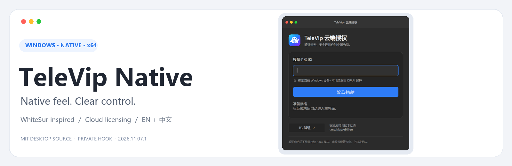
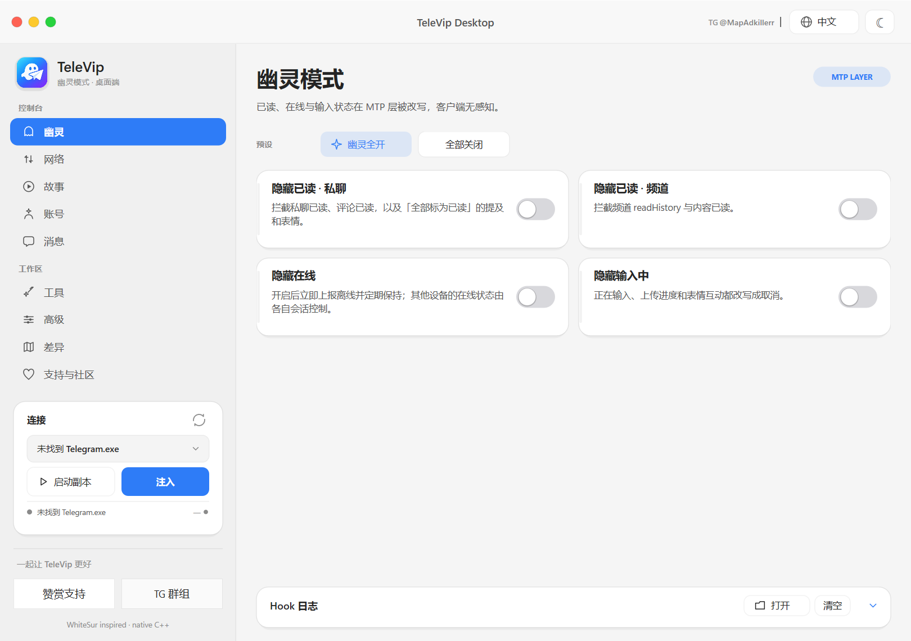
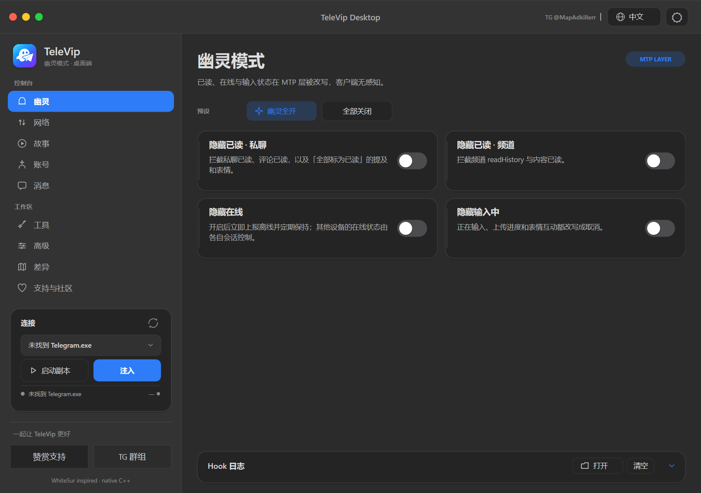
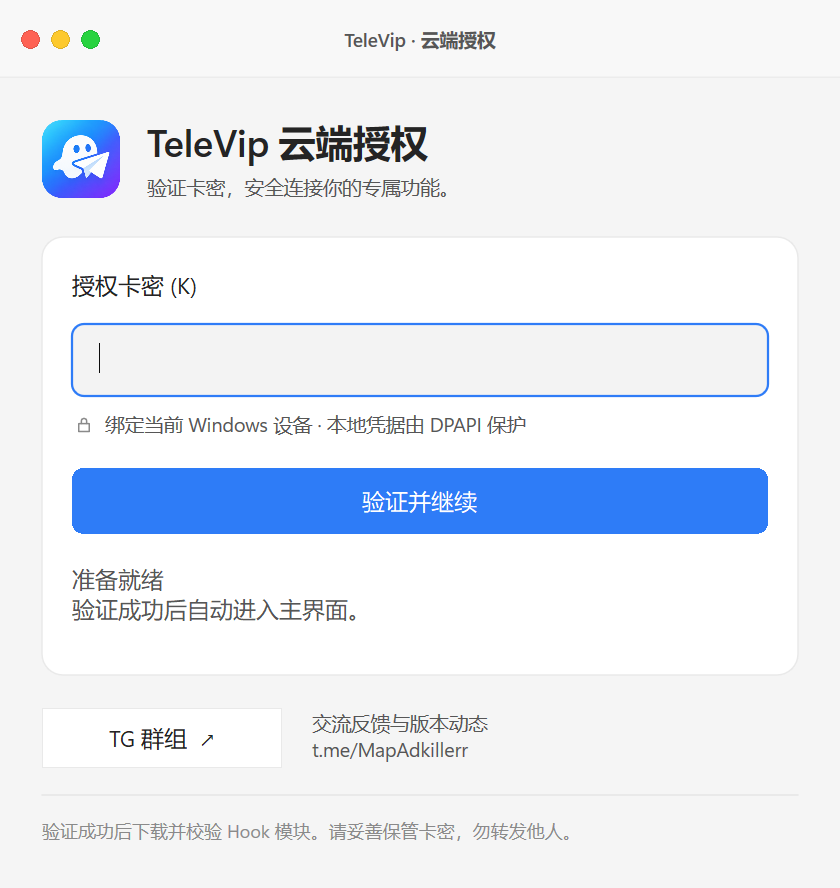
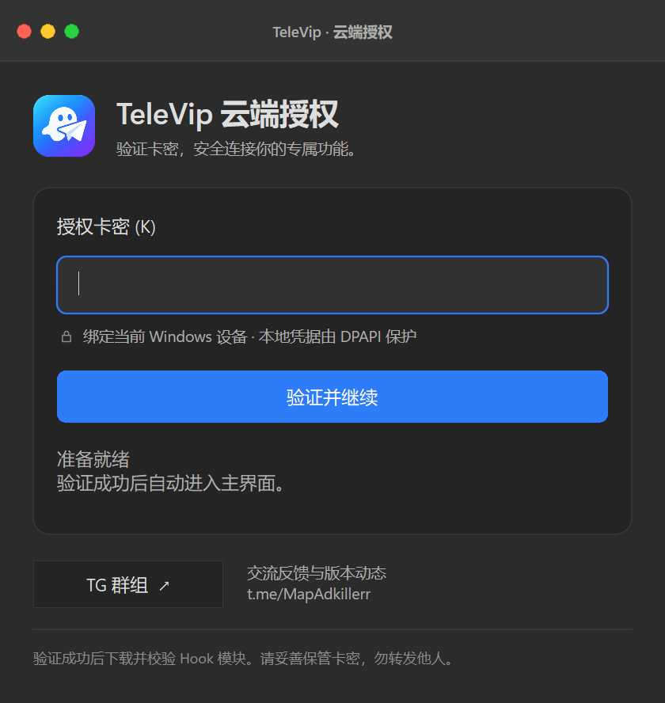

<p align="center"></p>
<p align="center"><a href="README.md">简体中文</a> · <b>English</b></p>
<h1 align="center">TeleVip Native</h1>
<p align="center">A native Windows control panel for Telegram Desktop enhancements</p>
<p align="center"></p>
<p align="center"><a href="https://github.com/ldxm666/TeleVipNative/releases/tag/v2026.11.07"><b>Download the stable release</b></a>　·　<a href="TRIAL_KEYS.md"><b>100 free trial keys</b></a>　·　<a href="https://t.me/MapAdkillerr">Join the release channel</a>　·　<a href="#free-license-keys">Free keys</a>　·　<a href="#help-and-feedback">Help</a></p>

---

TeleVip Native brings feature controls, online licensing and common tools into one native desktop interface. Its visual language is inspired by WhiteSur, with light and dark themes, English and Simplified Chinese, and consistent transitions throughout the app.

> **This is a closed-source distribution repository.** It contains user documentation, screenshots and client downloads. Proprietary client source, Hook implementations and server code are not published here. This is a stable release; Telegram version compatibility follows the release notes and in-app status labels.

## Free license keys

### Option 1: Claim directly on GitHub — first 100 keys

🎁 **[Open the free trial key list →](TRIAL_KEYS.md#claim-and-use)**

No group membership is required for this public batch. Each key lasts **24 hours from first activation**, binds to one Windows device and is available first come, first served. Claim status is not updated live.

### Option 2: Daily bot check-in

**Join the community release channel, then check in with the bot to receive a free license key.**

1. Join [Ldxm666 插件通知群 · release channel](https://t.me/MapAdkillerr).
2. Open the [free-key bot](https://t.me/TeleVip_ldxm666_bot) and press **Start**.
3. Send `/checkin` in the bot's **private chat**. Each Telegram account can claim one key per day, using the **Asia/Shanghai (UTC+8)** calendar date.
4. Enter the received key on the client's cloud activation screen.

**Status: the bot is live. Private check-ins are available while stock lasts.**

Repeated check-ins return the same key for that day and do not consume more stock. An empty inventory does not use up your daily claim: try again after a restock. The bot states the key's validity period; the initial stock consists of one-day time keys, starting on first activation. Keys bind to the Windows device on first activation. Keep them private.

## Interface preview

| Light theme | Dark theme |
| :---: | :---: |
|  |  |
|  |  |

The screenshots show Simplified Chinese; the app also supports English.

## Features and experience

| Area | What to expect |
| --- | --- |
| Native desktop UI | C++ / Direct2D / DirectWrite, with no Electron or WebView runtime dependency |
| Organized controls | Ghost, network, stories, account, messages, tools, advanced, differences and support pages |
| Online licensing | License verification followed by module signature and file-hash checks |
| Consistent interactions | Custom window controls, hover and press feedback, focus transitions and reduced-motion support |
| Appearance and language | Light / dark themes, accent colors, English / Simplified Chinese and keyboard navigation |
| Support and community | WeChat / Alipay donation codes, QR export and Telegram community links |

## Download and get started

**Requirements: Windows 10 / 11 x64 and an internet connection.**

1. Visit [GitHub Releases](https://github.com/ldxm666/TeleVipNative/releases) and download the Windows x64 ZIP for the intended version.
2. Extract the entire ZIP to a writable folder; do not run the app directly inside the archive.
3. Run `TeleVipNative.exe` and activate it with a valid key.
4. Select the target Telegram Desktop process in the app, then enable compatible features as needed.

The ZIP includes the client, user instructions and third-party notices. It does not include a side-loaded Hook DLL. The current binary is **not Authenticode signed**. Verify the source of your download and compare its hash with `SHA256SUMS.txt` in the same Release.

```powershell
Get-FileHash .\TeleVipNative.exe -Algorithm SHA256
```

The current verification covers activation, themes, keyboard navigation, QR export, transitions and cloud signature checks. Injection into the maintainer's existing Telegram process was **not rerun in this round**. Follow the compatibility notes for your Telegram version.

## Keyboard shortcuts

| Action | Shortcut |
| --- | --- |
| Switch pages | `Ctrl + 1` through `Ctrl + 9` |
| Next page | `Ctrl + Tab` |
| Move between native controls | `Tab` |
| Submit the activation key | `Enter` |

## Help and feedback

<details>
<summary><b>Why does the app need an internet connection?</b></summary>

The client verifies the key at startup and renews its session while running. If a key is disabled, expires or cannot renew, the client stops new operations and clears shared feature switches. Already injected modules or memory modifications may remain until the affected process is closed and restarted.
</details>

<details>
<summary><b>Why did another check-in return the same key?</b></summary>

An account receives one key per UTC+8 calendar day. Repeating `/checkin` retrieves that day's original key. If message delivery fails, the assignment is kept and the key is never returned to the pool for another person. Out-of-stock attempts do not consume a daily claim.
</details>

<details>
<summary><b>What if I change computers or see a device-binding error?</b></summary>

Keys bind to the current Windows device. Contact the maintainer through the release channel for binding support. Never post your key, device identifier or account credentials publicly.
</details>

<details>
<summary><b>Does every feature work with every Telegram version?</b></summary>

No. Low-level features depend on target-version compatibility. Some items remain experimental; follow the app's labels and the relevant release notes.
</details>

Report reproducible issues through [Issues](https://github.com/ldxm666/TeleVipNative/issues) or the [release channel](https://t.me/MapAdkillerr). Include the Windows, TeleVip Native and Telegram Desktop versions, steps to reproduce and redacted screenshots. Do not upload keys, tokens, session files or private conversations.

## Support development

Donations are voluntary and **do not automatically grant a license key**.

| WeChat support | Alipay support |
| :---: | :---: |
|  |  |

## Releases and licensing

- See the [English changelog](CHANGELOG.en.md) and [client releases](https://github.com/ldxm666/TeleVipNative/releases).
- Proprietary code is distributed in closed-source form. See [distribution terms](DISTRIBUTION.md#distribution-scope-english). Third-party components retain their original license rights.
- The visual design references [WhiteSur GTK Theme](https://github.com/vinceliuice/WhiteSur-gtk-theme). Its MIT notice is retained in [THIRD_PARTY_NOTICES](THIRD_PARTY_NOTICES.txt).
- Cloud licensing is adapted from [luckinhappykami](https://github.com/gaofee/luckinhappykami). The server is not distributed in this repository.
- This is an independent project with no official affiliation with Telegram. Closed-source distribution and online module delivery do not guarantee protection against reverse engineering.

<p align="center">TeleVip Native · A native interface, clear controls, steady improvements.</p>
