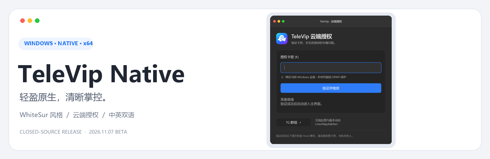
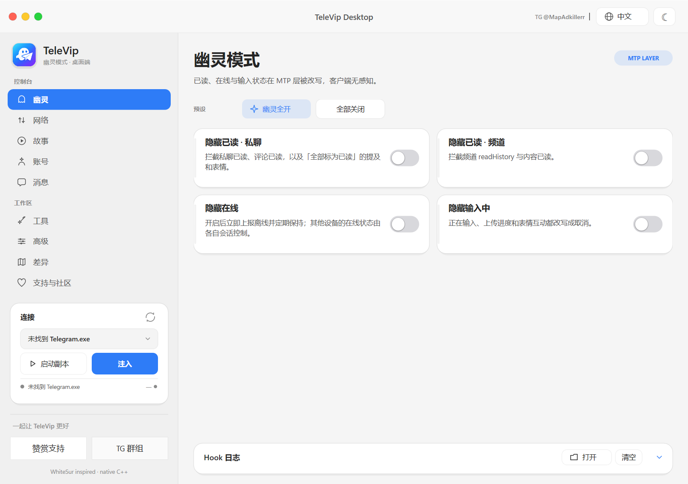
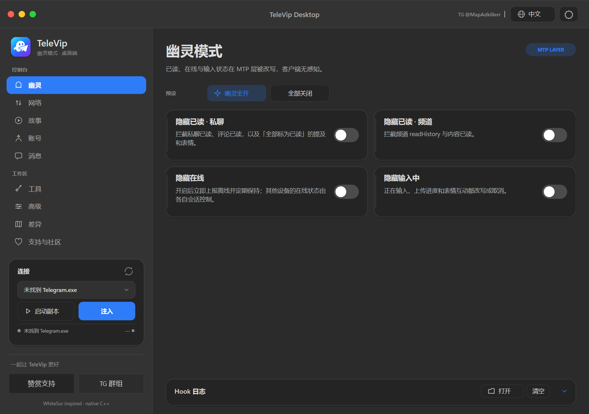
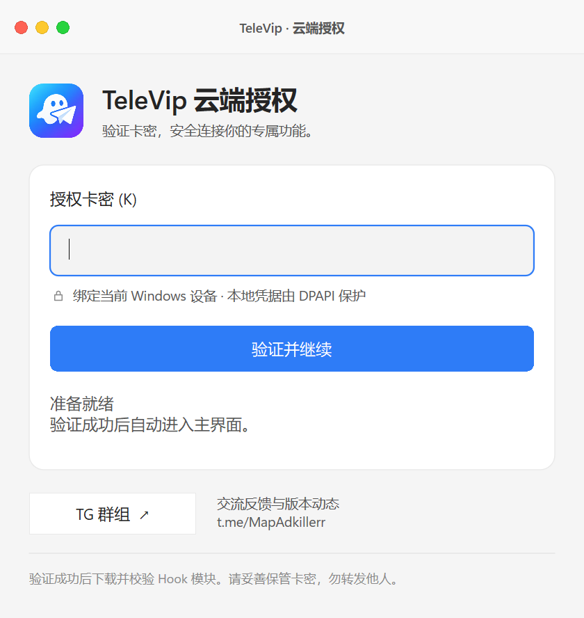
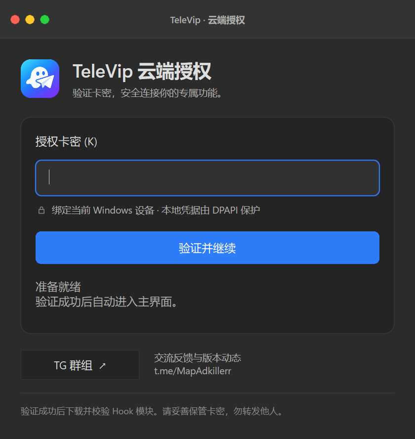

<p align="center"></p>
<p align="center"><b>简体中文</b> · <a href="README.en.md">English</a></p>
<h1 align="center">TeleVip Native</h1>
<p align="center">面向 Telegram Desktop 的 Windows 原生增强控制台</p>
<p align="center"></p>
<p align="center"><a href="https://github.com/ldxm666/TeleVipNative/releases/tag/v2026.11.07"><b>下载正式版</b></a>　·　<a href="https://t.me/MapAdkillerr">加入发布频道</a>　·　<a href="#免费卡密">免费卡密</a>　·　<a href="#问题与反馈">使用帮助</a></p>

---

TeleVip Native 将功能控制、授权验证与常用工具整合在一个原生桌面界面中。界面参考 WhiteSur 的视觉语言，提供深浅主题、中英双语，以及统一的页面与交互过渡。

> **这是闭源发布仓库。** 这里只分发使用说明、界面截图与客户端安装包；不公开自有客户端源码、Hook 实现或服务端。当前版本为正式发行版，目标 Telegram 的适配能力以版本说明与界面提示为准。

## 免费卡密

**进群 / 订阅发布频道，通过签到机器人获取免费卡密。**

1. 加入 [Ldxm666 插件通知群 · 发布频道](https://t.me/MapAdkillerr)。
2. 打开 [免费卡密机器人](https://t.me/TeleVip_ldxm666_bot)，先点击 **Start / 开始**。
3. 在机器人**私聊**发送 `/checkin` 签到。每个 Telegram 账号每天最多领取一张，日期按北京时间计算。
4. 将收到的卡密填入客户端的“云端授权”页面。

**当前状态：已开放：进入机器人私聊签到领取。**

重复签到会返回当天已分配的同一张卡，不会再扣库存；缺货时不消耗当天领取机会，补货后可重试。卡密有效期以发放提示为准，首次激活后绑定 Windows 设备。请勿在群里公开卡密。

## 界面预览

| 浅色主题 | 深色主题 |
| :---: | :---: |
|  |  |
|  |  |

## 使用体验

| 能力 | 说明 |
| --- | --- |
| 原生桌面界面 | C++ / Direct2D / DirectWrite，不依赖 Electron 或 WebView 运行时 |
| 清晰的功能分区 | 幽灵、网络、故事、账号、消息、工具、高级、差异与支持页面 |
| 云端授权 | 在线验证卡密，下载后校验模块签名及文件哈希 |
| 一致的交互 | 自绘窗口按钮、悬停与按压反馈、焦点与状态过渡，尊重系统减少动态效果选项 |
| 外观与语言 | 深浅主题、强调色、中英双语与键盘导航 |
| 支持与社区 | 内置微信 / 支付宝赞赏入口、二维码保存与 TG 社区链接 |

## 下载与开始使用

**环境：Windows 10 / 11 x64，联网使用。**

1. 打开 [GitHub Releases](https://github.com/ldxm666/TeleVipNative/releases)，下载当前版本的 Windows x64 ZIP。
2. 完整解压到可写目录，不要直接在压缩包内运行。
3. 运行 `TeleVipNative.exe`，输入有效卡密完成授权。
4. 按界面选择 Telegram Desktop 目标进程，再按需启用功能。

发布包包含客户端、面向用户的使用说明与第三方许可声明，不附带旁置 Hook DLL。当前二进制**未进行 Authenticode 代码签名**；请确认下载来源，并与同一 Release 的 `SHA256SUMS.txt` 校验。

```powershell
Get-FileHash .\TeleVipNative.exe -Algorithm SHA256
```

本版本已检查授权页、明暗主题、键盘导航、二维码导出、页面动效与云端签名校验；本轮未在维护者现有 Telegram 进程上重新验证注入。请先按目标版本的适配说明使用。

## 常用操作

| 操作 | 快捷方式 |
| --- | --- |
| 切换页面 | `Ctrl + 1` ～ `Ctrl + 9` |
| 下一页面 | `Ctrl + Tab` |
| 在原生控件间移动 | `Tab` |
| 授权页提交卡密 | `Enter` |

## 问题与反馈

<details>
<summary><b>为什么需要联网？</b></summary>

启动时需要在线验证，运行期间会续约。卡密停用、到期或续约失败时，客户端会停止新操作并清空共享功能开关；已经注入的模块或内存修改不保证立即撤销，需要退出相关进程后重新启动。
</details>

<details>
<summary><b>签到成功，但没有收到新卡？</b></summary>

同一账号当天重复签到会取回同一张卡。如果发送失败，可再次私聊 `/checkin`；系统保留原分配记录，不会把已分配卡重新发给别人。库存不足时请留意频道补货通知。
</details>

<details>
<summary><b>换电脑或提示已绑定怎么办？</b></summary>

卡密绑定当前 Windows 设备。请通过频道联系维护者处理解绑，不要公开卡密、设备标识或其他账户凭据。
</details>

<details>
<summary><b>所有功能都适配任意 Telegram 版本吗？</b></summary>

不是。底层功能依赖目标版本适配，部分项目仍处于实验阶段，以客户端标识与 Release 说明为准。
</details>

反馈可使用 [Issues](https://github.com/ldxm666/TeleVipNative/issues) 或 [TG 发布频道](https://t.me/MapAdkillerr)。请附 Windows 版本、客户端版本、Telegram 版本、复现步骤与脱敏截图，不要上传卡密、令牌或个人会话资料。

## 支持持续维护

赞赏完全自愿，**不与卡密发放自动关联**。

| 微信赞赏 | 支付宝赞赏 |
| :---: | :---: |
|  |  |

## 发布与许可

- 最新变更见 [CHANGELOG](CHANGELOG.md)，二进制见 [Releases](https://github.com/ldxm666/TeleVipNative/releases)。
- 自有代码采用闭源分发方式，范围说明见 [DISTRIBUTION](DISTRIBUTION.md)。第三方组件保留各自的许可权利。
- 界面视觉参考 [WhiteSur GTK Theme](https://github.com/vinceliuice/WhiteSur-gtk-theme)，MIT 声明随发布包保留，见 [第三方许可](THIRD_PARTY_NOTICES.txt)。
- 云端授权基于 [luckinhappykami](https://github.com/gaofee/luckinhappykami) 进行适配，服务端不在本仓库分发。
- 本项目为独立项目，与 Telegram 官方没有隶属关系。闭源和在线下发不构成“绝对防逆向”的保证。

<p align="center">TeleVip Native · 简洁的界面，明确的边界，持续的改进。</p>
